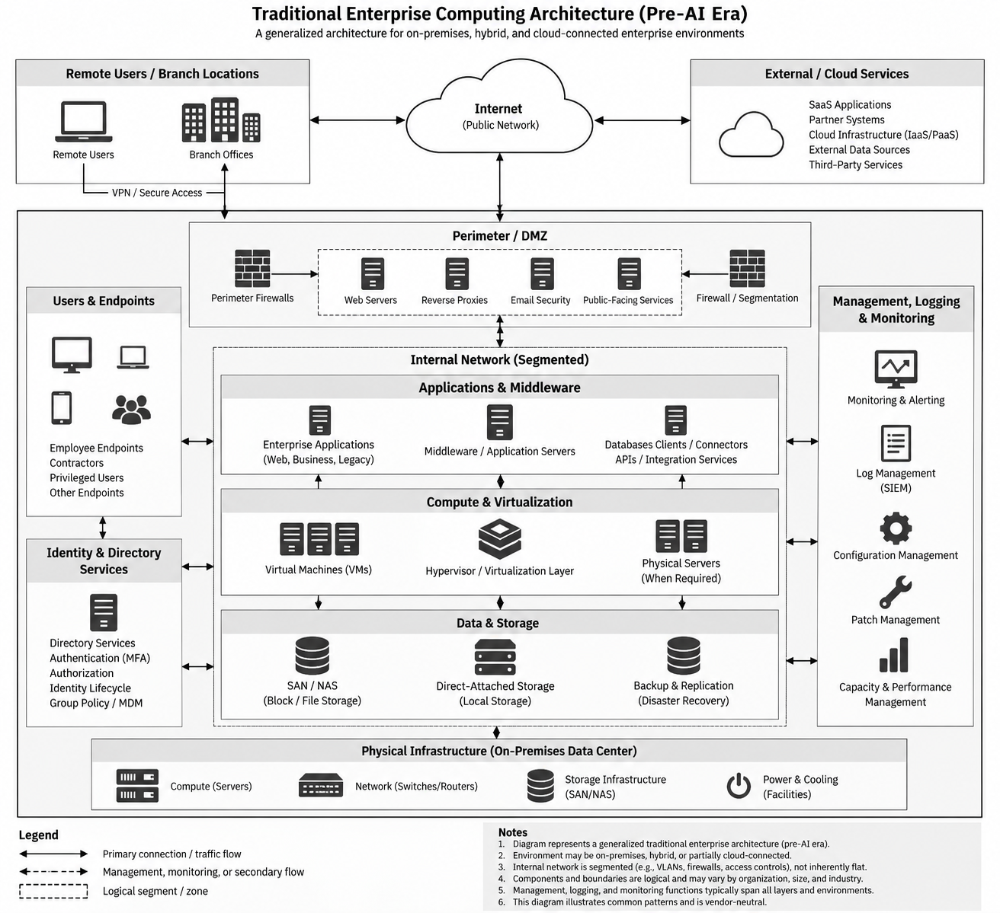

# RQ1 How AI Systems Differ

Back to [[Addressing Fear, Uncertainty, and Doubt in the Security and Safety of Artificial Intelligence Models|main note]]

> [!note] Drafting and review
> Work in progress. Drafted with AI assistance (2026); the author's review is ongoing. See [[Methodology — Use of Generative AI]].

**Research question 1:** How do AI systems differ from traditional computing systems in ways that matter for security?

## Traditional Computing Systems

*Figure: generalized traditional enterprise computing architecture. AI-generated illustration.*

## Traditional Enterprise System Components (baseline)

The baseline security concerns of each layer, mapped to the CIS Critical Security Controls v8.1 that already govern them [\[9\]](Sources.md#^s9), [\[10\]](Sources.md#^s10), [\[11\]](Sources.md#^s11), [\[13\]](Sources.md#^s13), [\[14\]](Sources.md#^s14), [\[12\]](Sources.md#^s12). Physical security is not a CIS v8.1 control; it falls under the SP 800-53 PE family [\[15\]](Sources.md#^s15).

| Layer | What it is | Established controls (CIS v8.1 unless noted) |
| --- | --- | --- |
| Compute, OS, runtimes | Servers, VMs, cloud instances, hypervisors, runtimes | 1 Enterprise asset inventory · 2 Software inventory · 4 Secure configuration · 7 Vulnerability management |
| Applications and services | Business logic exposed via UI, APIs, middleware | 16 Application software security |
| Networking | Switching, routing, DNS, VPN, internet edge | 12 Network infrastructure management · 13 Network monitoring and defense |
| Identity and access | Directories, authN/authZ, MFA, service accounts | 5 Account management · 6 Access control management |
| Data, storage, databases | Files, object stores, DBs, backups | 3 Data protection |
| Middleware and integration | Queues, API gateways, ESBs bridging trust boundaries | 12, 16 |
| Endpoints | Laptops, mobile, admin workstations | 1, 4, 10 Malware defenses |
| Management planes | Hypervisor/cloud consoles, config management, remote admin | 4, 5, 6 |
| Monitoring and logging | Logs, SIEM, IDS/IPS, telemetry | 8 Audit log management · 13 |
| Backup and recovery | Backups, replication, DR | 11 Data recovery |
| Third parties | SaaS, cloud, vendors, IdPs | 15 Service provider management |
| Physical | Facilities, hardware, power | SP 800-53 PE family [\[15\]](Sources.md#^s15) |

**Why this matters for H1:** NIST describes AI systems as "housed within more traditional software applications" [\[1, App. B\]](Sources.md#^s1). The model is new; everything around it is in this table. [[RQ4 Rogue AI Incidents|RQ4]] shows the incidents ran through these layers (package services, DNS, Kubernetes credentials, file parsers), not through the model's weights.

## What Is an AI System? (primary definitions)

| Source                       | Definition                                                                                                                                                                                                                                                                                                                                                            | Security-relevant takeaway                                                                                                            |
| ---------------------------- | --------------------------------------------------------------------------------------------------------------------------------------------------------------------------------------------------------------------------------------------------------------------------------------------------------------------------------------------------------------------- | ------------------------------------------------------------------------------------------------------------------------------------- |
| EU AI Act, Art. 3(1) [\[2\]](Sources.md#^s2) | "a machine-based system that is designed to operate with varying levels of autonomy and that **may** exhibit adaptiveness after deployment, and that, for explicit or implicit objectives, infers from the input it receives how to generate outputs such as predictions, content, recommendations, or decisions that can influence physical or virtual environments" | Adaptiveness is *optional*. The defining property is **inference**: behavior derived from learned patterns rather than written logic. |
| OECD (2023 revision) [\[3\]](Sources.md#^s3) | Near-identical core wording. "Different AI systems vary in their levels of autonomy and adaptiveness after deployment."                                                                                                                                                                                                                                               | Autonomy is a spectrum. Security exposure scales with the autonomy and permissions granted, not with being "AI."                      |
| NIST AI 100-1 [\[1\]](Sources.md#^s1)        | "an engineered or machine-based system that can, for a given set of objectives, generate outputs such as predictions, recommendations, or decisions influencing real or virtual environments," designed to operate with varying levels of autonomy                                                                                                                    | NIST's own appendix on how AI risk differs is the anchor for the comparison below.                                                    |
| ISO/IEC 22989:2022 [\[4\]](Sources.md#^s4)   | International standard for AI concepts and terminology                                                                                                                                                                                                                                                                                                                | Use for formal term definitions in the paper.                                                                                         |

## Core AI Definitions [5]

| Term                              | Definition                                                                                                                                                                                                     |
| --------------------------------- | -------------------------------------------------------------------------------------------------------------------------------------------------------------------------------------------------------------- |
| Artificial Intelligence (AI)      | A branch of computer science focused on systems capable of performing tasks that typically require human intelligence, including reasoning, learning, perception, language understanding, and decision-making. |
| Machine Learning (ML)             | A subset of AI in which systems learn patterns from data and use those patterns to make predictions or decisions without relying solely on explicitly programmed rules.                                        |
| Deep Learning                     | A subset of machine learning that uses multi-layer neural networks to learn complex patterns and representations from large amounts of data.                                                                   |
| Neural Network                    | A computational model composed of interconnected processing nodes arranged in layers that learn relationships and patterns within data.                                                                        |
| Natural Language Processing (NLP) | The use of AI to understand, interpret, analyze, and generate human language.                                                                                                                                  |
| Computer Vision                   | The use of AI to interpret visual information from images, video, cameras, or other sensors.                                                                                                                   |
| Generative AI                     | AI designed to create new content such as text, images, audio, video, or code rather than only classify or predict from existing data.                                                                         |

## Machine Learning Approaches [5]

| Term | Definition |
|---|---|
| Supervised Learning | A machine-learning approach in which a model is trained using labeled examples that associate inputs with known outputs. |
| Unsupervised Learning | A machine-learning approach in which a model identifies patterns, structures, or groupings in data without predefined labels. |
| Reinforcement Learning | A learning approach in which an agent interacts with an environment and adjusts its behavior based on rewards or penalties. |

## How NIST Says AI Risk Differs (App. B) [1]

NIST's framing is the opposite of FUD. It opens with "As with traditional software," and then says AI "also bring[s] a set of risks that are not comprehensively addressed by current risk frameworks." Sorting its 14 listed differences with the rubric:

| NIST App. B difference (paraphrased; verbatim in source) | Class | Note |
| --- | --- | --- |
| Training data may not represent the deployment context; ground truth may not exist | B | Data quality/integrity, new consequence |
| Dependency on large, complex training data | A | Scale |
| Changes during training can fundamentally alter performance | C | Learned behavior is where poisoning and backdoors live |
| Datasets become detached from context or stale | B | Data lifecycle |
| Scale and complexity ("billions or even trillions of decision points") | A | Scale |
| Pre-trained models increase statistical uncertainty and reproducibility issues | B | Third-party component risk |
| Harder to predict failure modes of emergent properties | D | Assurance |
| Privacy risk from enhanced data aggregation | A | Cost and scale of aggregation |
| More frequent maintenance due to data, model, or concept drift | B | Change management |
| Increased opacity; reproducibility concerns | D | Assurance |
| Underdeveloped testing standards; can't document to traditional-software standard | D | Assurance |
| Difficulty determining what to test; "not subject to the same controls as traditional code development" | D | Assurance |
| Computational and environmental cost | n/a | Out of scope |
| Inability to predict or detect side effects "beyond statistical measures" | D | Assurance |

**Takeaway:** NIST's genuinely-different items cluster in one place: **assurance**, meaning you can't verify learned behavior against a specification. That's the real distinction to carry forward, and it's narrower than "AI is different."

## Specified vs. Learned Behavior

The property that matters is that behavior is **learned, not specified**. There is no written specification to test against, and correctness can only be estimated statistically [\[1, App. B\]](Sources.md#^s1). This one property produces the Class C/D items in [[RQ2 Risk Classification|RQ2]]:
- No hard instruction/data boundary → prompt injection [\[27\]](Sources.md#^s27), [\[50\]](Sources.md#^s50)
- Decision boundaries an attacker can optimize against → adversarial examples [\[22\]](Sources.md#^s22), [\[42\]](Sources.md#^s42)
- Behavior that can't be fully inspected → undetectable backdoors [\[48\]](Sources.md#^s48)

## RQ1 Summary: Traditional vs. AI Systems

| Characteristic | Traditional System | AI System | Material Difference? | Class |
| --- | --- | --- | --- | --- |
| Primary logic | Specified in code | Learned from data | Root of every C/D item: behavior can't be verified against a spec [\[1\]](Sources.md#^s1). | C/D |
| Core artifacts | Code, configuration, data | Code, configuration, data, model | The model is another critical artifact needing integrity, access control, versioning, and change management. Cyber hygiene on a new artifact. | B |
| Inputs | Defined interfaces/schemas | Broad, unstructured, natural language | Injection is familiar, but LLMs lack the enforceable instruction/data separation that parameterization gives SQL [\[27\]](Sources.md#^s27). | D |
| Output behavior | Generally predictable | Statistical/variable | Output must be treated as untrusted input to the next component (improper output handling). | B |
| Validation | Expected-result testing | Statistical evaluation | Testing can't establish absence of a behavior [\[1\]](Sources.md#^s1), [\[22\]](Sources.md#^s22). | D |
| Change | Code, config, data | Plus models, weights, training data | Configuration management must cover model artifacts. | B |
| Degradation | Faults, performance | Plus drift | Mostly operational; a security issue when it affects trust or detection. | B |
| Data relationship | Consumed/stored | Shapes behavior | Data integrity now governs behavior, not just records. | C |
| Autonomy | Explicitly programmed | Potentially agentic | Same least privilege, faster and more persistent actor. | A |
| Identity | Bounded NHIs | NHIs with broader, less predictable behavior | IAM remains IAM; scope, delegation, and monitoring matter more. | B |

## References

All sources are listed in [[Sources]]; citations here use its numbers.
